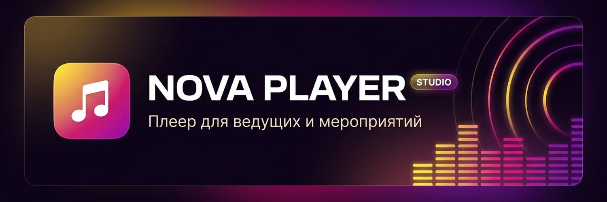
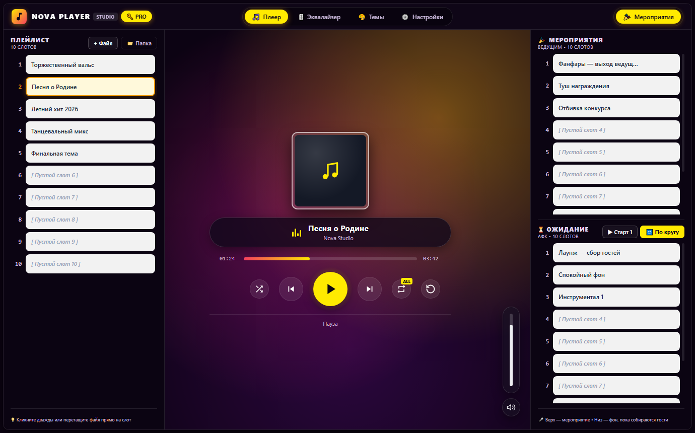
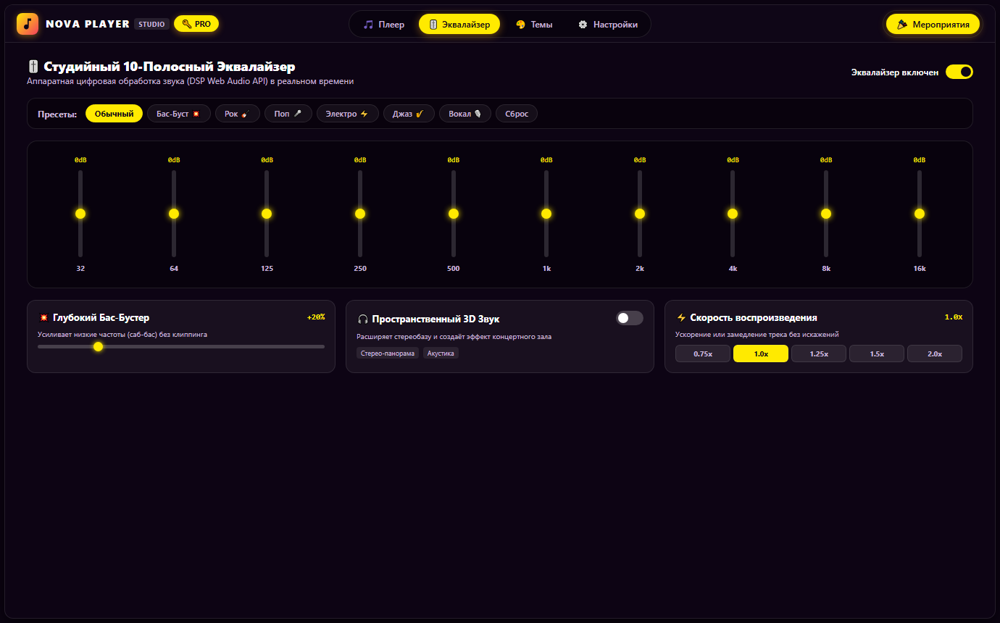
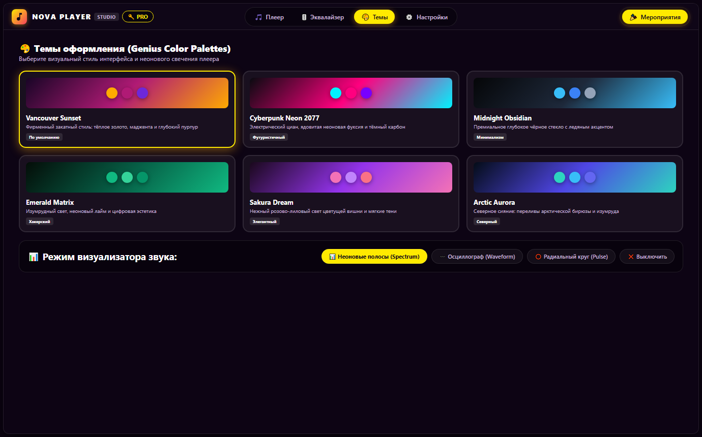

# 🎵 Nova Player Studio

**Музыкальный плеер для ведущих, Домов культуры и мероприятий**

---

## ✨ Возможности

| | Функция | Описание |
|---|---|---|
| 🎵 | **Основной плейлист** | 10+ слотов, перетаскивание файлов и слотов одной рукой (`3 → 7`, `3 ↔ 7`), точные названия файлов |
| 🎉 | **Мероприятия** | Отдельный плейлист для ведущих: фанфары, туш, отбивки конкурсов |
| ⏳ | **Ожидание (АФК)** | Фоновая музыка, пока собираются гости: `▶ Старт 1` и режимы `🔁 По кругу` / `➡ 1→2→3 стоп` |
| 🎚️ | **10-полосный эквалайзер** | Пресеты, бас-бустер, 3D-звук, скорость воспроизведения |
| 🎨 | **6 тем оформления** | Vancouver Sunset, Cyberpunk, Obsidian, Matrix, Sakura, Aurora |
| 🔀 | **Crossfade** | Плавное сведение треков при переключении |
| 🔄 | **Автообновление** | Новая версия скачивается из GitHub с прогрессом и плеер сам перезапускается |
| 🔑 | **Лицензия** | Активация ключом `VB-XXXX-…` — один раз и навсегда |

---

## 📸 Скриншоты

<b>Главный экран:</b> плейлист • сцена • «Мероприятия» и «Ожидание»

  

&nbsp;

<b>Эквалайзер</b> и <b>темы оформления</b>

---

## ⬇️ Установка

1. Откройте [**последний релиз**](https://github.com/sakleam1414/nova-player/releases/latest).
2. Скачайте **`MusicPlayer.exe`**.
3. Запустите и введите лицензионный ключ в окне активации.

> [!TIP]
> Ключ сохраняется навсегда — при следующих запусках вводить его не нужно.
> Обновления приходят автоматически: внизу слева появится кнопка **🔄 Обновить**.

---

## ⌨️ Горячие клавиши

| Клавиша | Действие |
|---|---|
| `Пробел` | Воспроизведение / Пауза |
| `←` `→` | Перемотка на 5 сек |
| `Ctrl` + `←` `→` | Предыдущий / следующий трек |
| `↑` `↓` | Громкость |
| `M` | Без звука |
| `L` | Режим повтора |
| `S` | Случайный порядок |

---

## 🔑 Получить ключ

Для получения лицензионного ключа свяжитесь с автором: [**@sakleam1414**](https://github.com/sakleam1414)

Сделано с ❤️ для ведущих и Домов культуры • © 2026 Nova Studio

